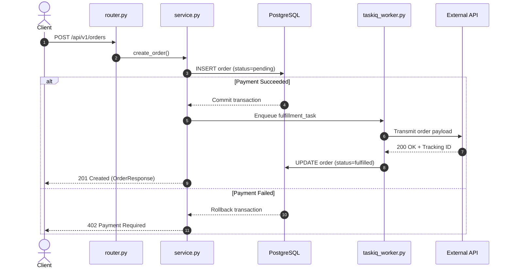

# Ask Skill: Deep Codebase Investigation & Explanation

Use this skill whenever the user asks questions about the codebase ("how does X work?", "explain Y", "trace Z", "what happens when...").

This skill prohibits superficial, surface-level explanations. Every answer must be mechanically grounded in actual source code, call chains, data structures, and edge cases.

---

## The Anti-Surface-Level Mandate (Core Invariant)

Every response generated by this skill must satisfy these four technical depth criteria:

1. **Full Execution Path Tracing**:
   Trace from the entry point (API router, CLI command, webhook, or cron task) through the domain service, database transaction/model, worker queue or relay outbox, to the external integration and final response or error.

2. **Mandatory Source Anchoring**:
   Every architectural claim, state transition, and logic branch must cite exact file paths and line ranges using standard markdown links (e.g. `[ClassName](file:///path/to/file#L10-L25)`). Never describe a system based only on high-level filenames or docstrings.

3. **Invariants and Boundary Conditions**:
   State the exact preconditions, locks, validation constraints, idempotent keys, and transactional boundaries.

4. **Failure Modes and Rollbacks**:
   Explicitly explain what happens when things fail: database rollbacks, HTTP error codes, retry loops, DLQs (dead letter queues), rate limits, or network timeouts.

---

## The Three Explanation Modalities

### Modality 1: ASD-STE100 (Default)

Use ASD-STE100 (Simplified Technical English) as the default format for all text explanations, code reviews, and architectural walk-throughs.

#### ASD-STE100 Rules:
- **Sentence Length**:
  - Maximum 25 words for descriptive sentences.
  - Maximum 20 words for procedural or instruction sentences.
- **Voice**:
  - Use active voice only. Do not use passive voice.
  - Example: Write "The router validates the payload." Do not write "The payload is validated by the router."
- **Vocabulary and Tone**:
  - Use simple, approved, unambiguous words.
  - Technical terms (e.g. FastAPI, SQLAlchemy, Taskiq, webhook) are allowed as technical nouns.
  - Do not use more than three consecutive nouns in a noun cluster.
  - Do not use colloquialisms, buzzwords, metaphors, or vague adjectives (e.g. "robust", "seamless", "flexible").
- **Paragraphs and Lists**:
  - Keep paragraphs short (maximum 6 sentences).
  - Use bullet points or numbered lists for sequential steps.

---

### Modality 2: Diagram (Mermaid Architecture & Flow)

Use diagrams whenever:
- The user requests a visual explanation (`--diagram`, "draw", "flowchart", "sequence diagram").
- The explanation spans asynchronous boundaries (e.g. HTTP route $\rightarrow$ DB outbox $\rightarrow$ Taskiq worker $\rightarrow$ external API).
- Complex state transitions or race conditions are involved.

#### Diagram Requirements:
- Use Mermaid code blocks (`sequenceDiagram`, `flowchart TD/LR`, `stateDiagram-v2`, or `classDiagram`).
- Every node, actor, and message in the diagram must reflect actual code symbols, function names, and database tables.
- Show both the **happy path** and **failure / error branches** (e.g. `alt / else` blocks in sequence diagrams).
- Keep labels concise and readable.

Example:

---

### Modality 3: HTML / Untracked Scratch Artifacts

Use Modality 3 whenever:
- The user asks for an interactive explorer, standalone report, matrix, or visual dashboard (`--html`, "build a page", "interactive report").
- The analysis is too broad or multifaceted for standard terminal chat (e.g. full-repo security audit, comprehensive schema comparison matrix).

#### Critical Rules for HTML Artifacts:
1. **Never Pollute the Git Repository**:
   - Write HTML files **only** to untracked scratch directories:
     - The conversation artifact directory: `<appDataDir>/brain/<conversation-id>/scratch/`
     - Or a git-ignored directory such as `.artifacts/` or `.trail/cache/scratch/`.
   - Never commit or stage these scratch HTML files in git.
2. **Design Quality (Aesthetics & Usability)**:
   - Self-contained single file with inlined CSS and minimal vanilla JS.
   - Modern dark mode styling, curated color palette, clean typography (Inter / system fonts), and responsive layout.
   - Interactive features where relevant: tab switching, filterable tables, expandable code blocks, search bars.
3. **Delivery**:
   - In your response, give the absolute file URI link so the user can open it immediately (e.g. `[Open Report](file:///path/to/scratch/report.html)`).

---

## Operating Protocol

When answering a question:

1. **Investigate Before Answering**:
   - Consult the codebase context graph first (`trail ask "<query>" --source`, `trail callers <symbol>`, or `trail grep`).
   - Open source files at exact lines to verify implementation details.
2. **Select Modality**:
   - **Default**: Use **Modality 1 (ASD-STE100)**.
   - If a flow or lifecycle is explained: Include a **Modality 2 (Mermaid Diagram)** inside the ASD-STE100 structure.
   - If an interactive deep-dive or visual file is requested: Generate **Modality 3 (HTML in scratch)** and summarize the findings using **Modality 1**.
3. **Verify Depth**:
   - Check that all four anti-surface-level criteria (call path, source links, invariants, failure modes) are present before concluding.
