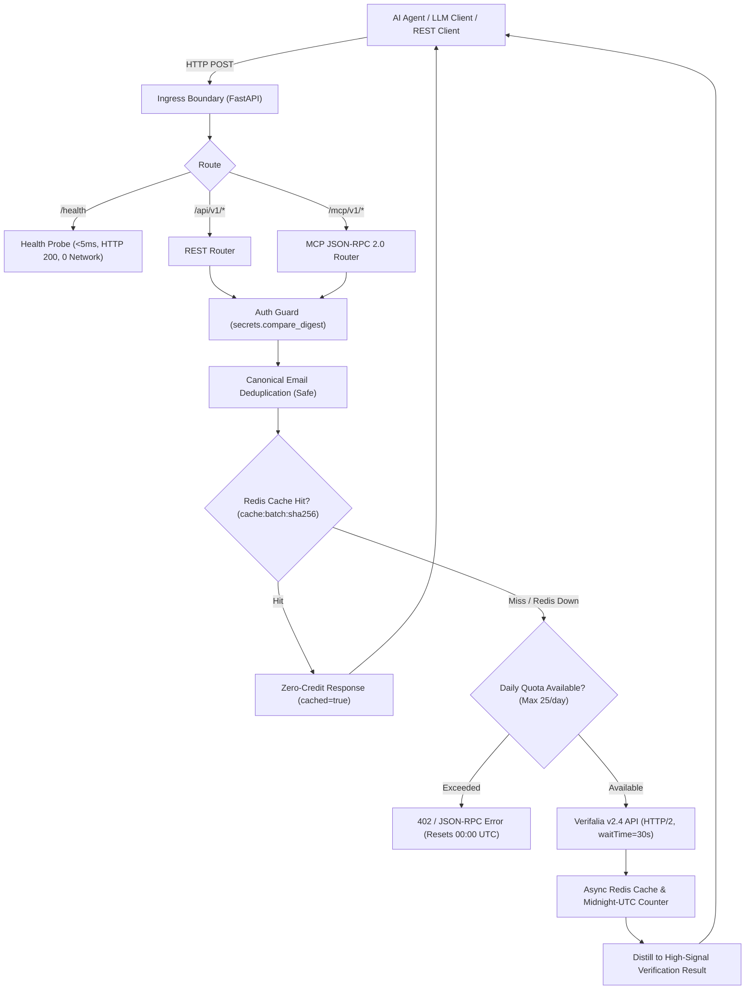

# muscar_mail

[](https://www.python.org/)
[](https://fastapi.tiangolo.com/)
[-orange.svg)](https://modelcontextprotocol.io/)
[](https://opensource.org/licenses/MIT)
[]()

**muscar_mail** is an ultra-lean, stateless **Model Context Protocol (MCP)** server and REST API for high-confidence email deliverability verification powered by the **Verifalia v2.4 API**.

Engineered specifically for autonomous AI agents, distributed agent sandboxes, and modern LLM toolchains, it runs serverless-ready on Render free-tier containers with **zero SQL databases**, sub-2-second cold starts, fail-open Redis caching, and strict daily quota protection.

---

## 🌟 Key Features & Invariants

- **Dual-Interface Ingress**:
  - **Stateless MCP Endpoint**: Pure HTTP JSON-RPC 2.0 at `POST /mcp/v1/` (and `/mcp/v1`) — supporting the latest **`2026-07-28`** revision with dynamic negotiation for backwards-compatible clients (`2025-11-25`, `2024-11-05`), `MCP-Protocol-Version` HTTP headers, and capability discovery (`server/discover`).
  - **Clean REST API**: Standard OpenAPI/Swagger REST endpoints at `POST /api/v1/verify` and `GET /api/v1/credits`.
- **Render Free-Tier Serverless Design**:
  - Cold boots in **< 2 seconds** with zero eager database migrations or blocking network queries.
  - Instantaneous (< 5ms) zero-network health check at `GET /health` (`status: healthy`).
  - Graceful async lifespan management that closes HTTP/2 socket pools and Redis connections when Render puts containers to sleep after 15 minutes of inactivity.
- **Strict Credit & Quota Protection**:
  - **Hard Batch Boundary**: Enforces a strict ceiling of **1 to 25 emails per batch** directly at the schema/route boundary.
  - **Safe Deduplication**: Normalizes canonical emails so repeated addresses in a batch only consume 1 credit.
  - **Zero-Credit Batch Recovery**: Hashes batch inputs (`cache:batch:<sha256>`) in Redis to serve identical verification requests with 0 credit cost.
  - **Midnight-UTC Quota Guard**: Enforces Verifalia's free-tier limit (25 credits/day) using atomic Redis counters expiring exactly at `00:00:00 UTC`.
- **Fail-Open Resilience**:
  - Redis connection drops, timeouts, or network partitions **never** fail email verifications; the service logs a warning and fails open directly to Verifalia.
- **Production-Grade Security**:
  - Constant-time API key comparisons via `secrets.compare_digest` supporting `Authorization: Bearer <key>` and `X-API-Key: <key>`.
  - Automatic recursive redaction of sensitive credentials, headers, and tokens in structured JSON logs via `structlog`.
  - OWASP API8-compliant CORS configuration with uncredentialed wildcard support (`Access-Control-Allow-Origin: *`).

---

## 🏗️ Architecture & Request Flow



---

## 🛠️ MCP Tools Catalog

When connected over MCP (`POST /mcp/v1/`), muscar_mail exposes 3 high-signal tools:

| Tool Name | Parameters | Description |
|---|---|---|
| `verify_emails` | `emails: string[]` (1–25 items) | Synchronously verifies deliverability via Verifalia, deduplicating addresses and checking Redis cache first. Returns compact summary. |
| `get_cached_verification` | `emails: string[]` (1–25 items) | Queries the Redis cache for previous verification results for this exact batch without invoking Verifalia or consuming credits. |
| `get_credit_balance` | *(none)* | Queries current Verifalia credit balance, daily free credits, and the exact ISO 8601 UTC reset timestamp (`00:00:00 UTC`). |

### High-Signal Distilled Schema

Rather than inundating LLM context windows with verbose DNS, MX, and SMTP logs, muscar_mail distills each result into a compact record:

```json
{
  "email": "user@example.com",
  "classification": "Deliverable",
  "status": "Success",
  "is_deliverable": true,
  "is_disposable": false,
  "is_role_account": false,
  "is_free_email": false
}
```

---

## 🚀 Deployment Guide (Render)

Deploying `muscar_mail` as a Web Service on Render takes under 3 minutes:

### 1. Build & Start Settings

| Field | Value | Notes |
|---|---|---|
| **Runtime** | `Python` | Target runtime Python >= 3.12 (Python 3.14 ready) |
| **Build Command** | `pip install --upgrade pip && pip install -r requirements.txt` | Pins all production dependencies |
| **Start Command** | `uvicorn main:app --host 0.0.0.0 --port $PORT` | Binds to Render's dynamic `$PORT` |
| **Health Check Path** | `/health` | Zero-network health probe responding in <5ms |

### 2. Environment Variables

Configure the following environment variables in Render's **Environment** tab:

| Variable | Required | Default | Description |
|---|---|---|---|
| `VERIFALIA_USERNAME` | **Yes** | — | Your Verifalia username (from [Verifalia Client Area](https://verifalia.com/client-area)) |
| `VERIFALIA_PASSWORD` | **Yes** | — | Your Verifalia API password |
| `MCP_API_KEYS` | **Yes** | — | Comma-separated secret keys for client authentication (e.g. `key1,key2`) |
| `REDIS_URL` | **Yes** | — | Redis connection URL (e.g. Upstash, Redis Cloud, or Render Key-Value) |
| `ENVIRONMENT` | No | `production` | `production` (JSON logging) or `development` (colorized) |
| `DEBUG` | No | `false` | Enables debug logging if set to `true` |
| `SENTRY_DSN` | No | `None` | Optional Sentry DSN for error telemetry (fails open if omitted) |
| `VERIFALIA_WAIT_TIME_MS`| No | `30000` | Upstream synchronous wait ceiling in milliseconds |

> **Note on HOST & PORT**: You do **not** need to set `HOST` or `PORT` in Render's environment dashboard. Render injects `$PORT` dynamically, and the start command automatically consumes it.

---

## 💻 Local Development Setup

### Prerequisites
- Python 3.14+ (or Python 3.12+)
- Git
- Redis (optional, local or cloud instance; service fails open if omitted)

### Setup Steps

```bash
# 1. Clone the repository
git clone https://github.com/your-username/muscar_mail.git
cd muscar_mail

# 2. Create and activate virtual environment
python3 -m venv .venv
source .venv/bin/activate

# 3. Install pinned dependencies
pip install --upgrade pip && pip install -r requirements.txt

# 4. Configure environment
cp .env.example .env
# Edit .env with your VERIFALIA_USERNAME, VERIFALIA_PASSWORD, and MCP_API_KEYS

# 5. Run the application
uvicorn main:app --host 0.0.0.0 --port 8000 --reload
# Or directly:
python main.py
```

Interactive API documentation will be available at:
- Swagger UI: `http://localhost:8000/docs`
- ReDoc: `http://localhost:8000/redoc`
- OpenAPI JSON: `http://localhost:8000/openapi.json`

---

## 🧪 Usage Examples

### 1. Operational Verification Script (Zero Dependencies)

Verify your local or deployed Render instance end-to-end (health check, JSON-RPC ping, protocol handshake, tools catalog, credits balance, and cache recovery):

```bash
# Verify local instance
python scripts/test_mcp_client.py --api-key your_mcp_api_key

# Verify live Render deployment without spending credits
python scripts/test_mcp_client.py --base-url https://your-muscar-mail.onrender.com --api-key your_key --skip-verify
```

### 2. Generating API Keys

Generate a cryptographically secure token using Python:

```bash
python3 -c "import secrets; print(secrets.token_urlsafe(32))"
```

### 3. MCP JSON-RPC 2.0 (`POST /mcp/v1/`)

#### Tools List (`tools/list`):
```bash
curl -X POST http://localhost:8000/mcp/v1/ \
  -H "Authorization: Bearer your_mcp_api_key" \
  -H "Content-Type: application/json" \
  -d '{
    "jsonrpc": "2.0",
    "id": "1",
    "method": "tools/list"
  }'
```

#### Verify Email Batch (`tools/call`):
```bash
curl -X POST http://localhost:8000/mcp/v1/ \
  -H "Authorization: Bearer your_mcp_api_key" \
  -H "Content-Type: application/json" \
  -d '{
    "jsonrpc": "2.0",
    "id": "2",
    "method": "tools/call",
    "params": {
      "name": "verify_emails",
      "arguments": {
        "emails": ["alice@gmail.com", "bob@example.org"]
      }
    }
  }'
```

### 4. REST API (`POST /api/v1/verify`)

```bash
curl -X POST http://localhost:8000/api/v1/verify \
  -H "Authorization: Bearer your_mcp_api_key" \
  -H "Content-Type: application/json" \
  -d '{
    "emails": ["alice@gmail.com", "support@github.com"]
  }'
```

### 5. Check Credits (`GET /api/v1/credits`)

```bash
curl -X GET http://localhost:8000/api/v1/credits \
  -H "Authorization: Bearer your_mcp_api_key"
```

---

## 🚦 Automated Test Suite

muscar_mail maintains a comprehensive, zero-regression test suite covering schema boundaries, fail-open Redis behavior, Verifalia API adapters, JSON-RPC 2.0 error mapping, lifespan shutdown, and CORS security:

```bash
# Run all tests
pytest tests/ -v

# Run with test coverage
pytest tests/ --cov=.
```

**Test Breakdown**:
- `tests/test_milestone1.py`: Configuration validation, constant-time auth, structlog redaction, cold-boot benchmark.
- `tests/test_verification.py`: Verifalia service polling ladder, batch constraints, Safe deduplication, Redis caching.
- `tests/test_mcp.py`: Full JSON-RPC 2.0 compliance, tool dispatch, error code mappings (-32700, -32600, -32601, -32602, -32603).
- `tests/test_main.py`: Lifespan startup/shutdown, CORS preflight, zero-network health probe, OpenAPI routes.

---

## 📜 License

This project is licensed under the [MIT License](LICENSE).
